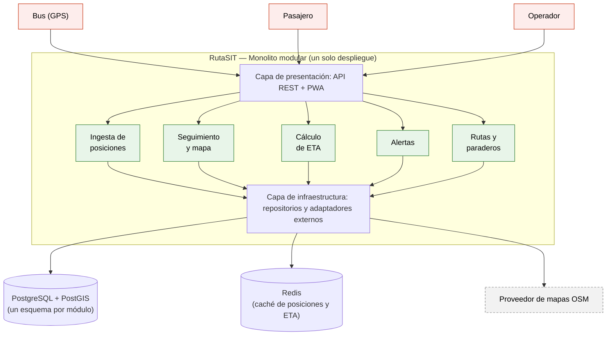
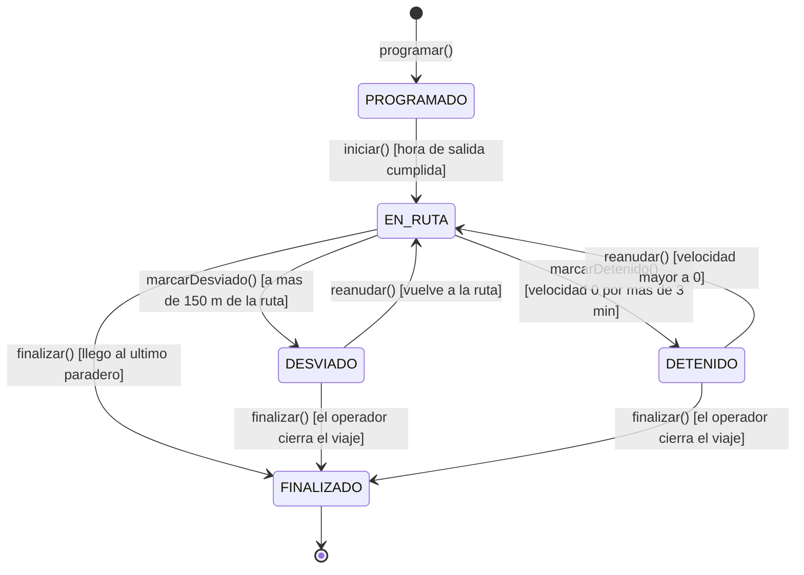
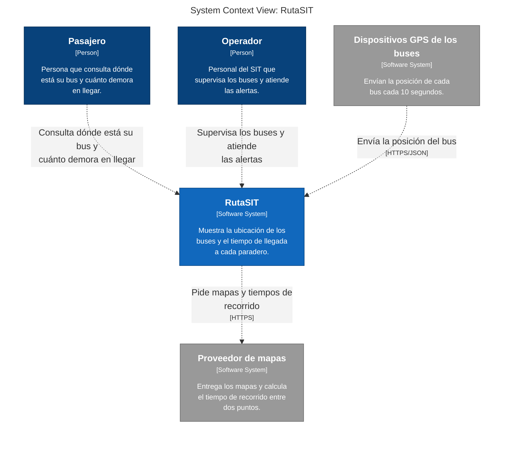
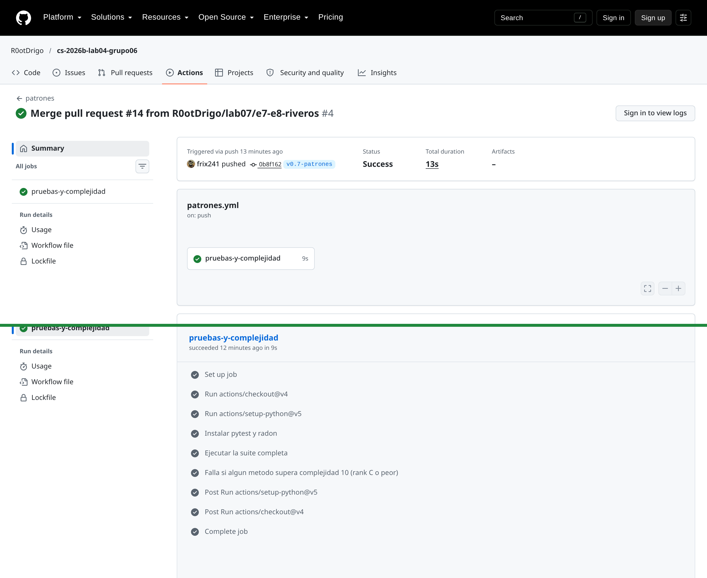
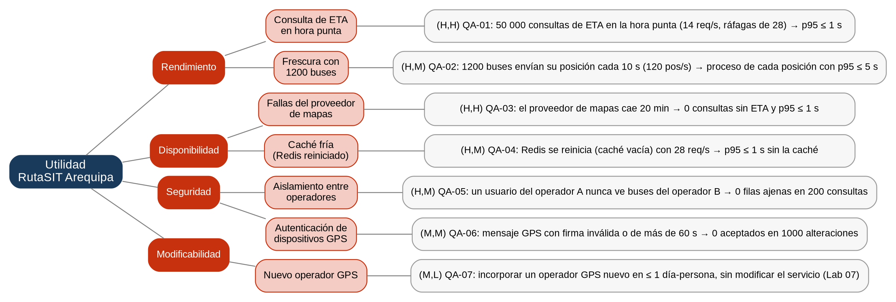
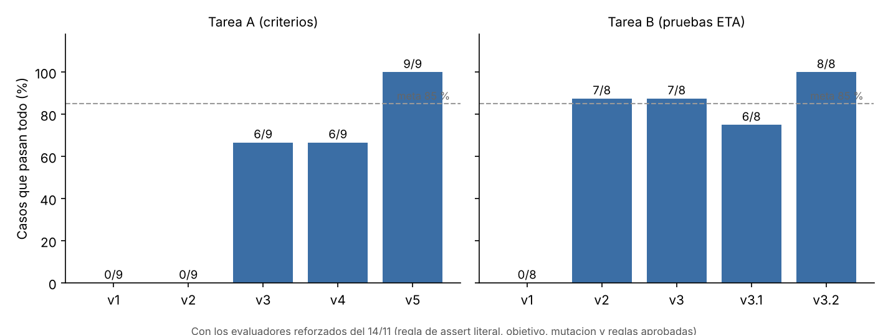
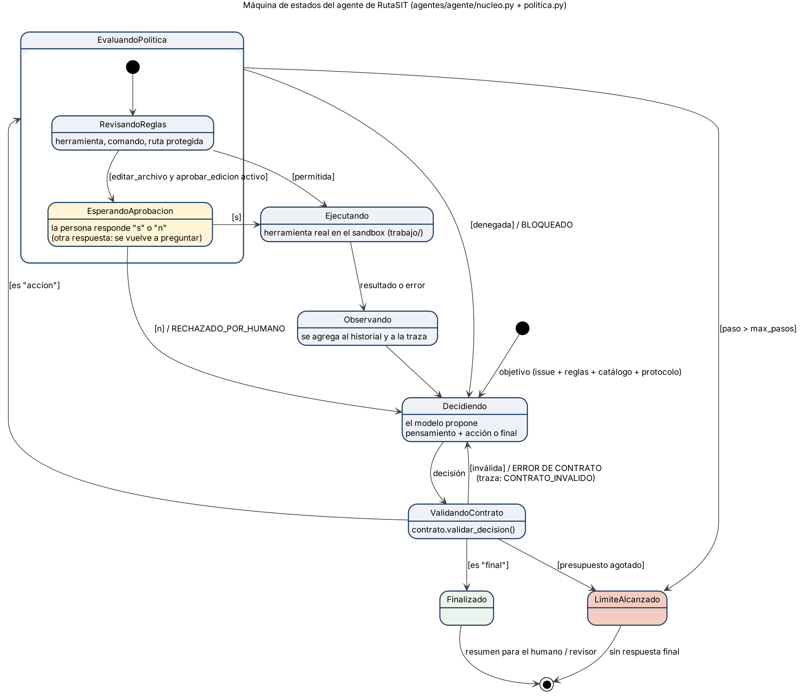
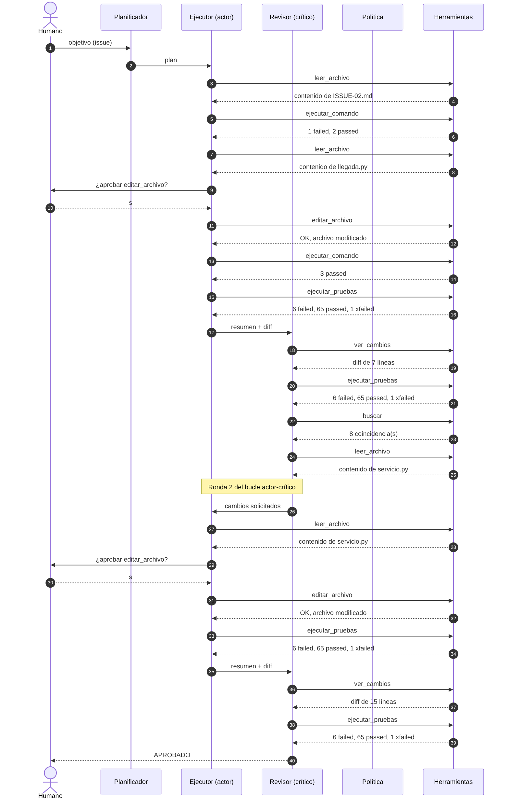

# RutaSIT Arequipa — Laboratorio 04: Fundamentos de arquitectura de software

Construcción de Software · EPIS-UNSA · 2026-B · **Grupo 06**

## Integrantes

| Nombre | Rol en el laboratorio |
|--------|-----------------------|
| Estefanero Palma Rodrigo | Arquitecto/analista: drivers, matriz de decisión, ADR-001 |
| Sullca Mamani Mauro Snayder | Diagramador: Mermaid, PlantUML, vista de despliegue |
| Riveros Vilca Alberth Edwar | Verificador de IA y documentación: bitácora, ADR-002/003, README |

## Caso

RutaSIT Arequipa permite a los pasajeros ver en un mapa la ubicación de los buses del
Sistema Integrado de Transporte y el tiempo estimado de llegada a su paradero, y avisa
al operador de desvíos o congestión. 300 buses envían su posición cada 10 s. El atributo
de calidad crítico es el rendimiento en tiempo real: el ETA debe estar disponible en
≤ 15 s (p95). El MVP debe estar en producción en 1 mes con 3 developers y un solo VPS.

## Arquitectura elegida

Monolito modular en Django, con PostgreSQL + PostGIS como almacenamiento y Redis como
caché de posiciones y ETA. Un solo despliegue, cinco módulos (Ingesta, Seguimiento, ETA,
Alertas, Rutas) que se comunican únicamente por interfaces públicas.

Fuente del diagrama: [`docs/architecture/diagramas/arquitectura.mmd`](docs/architecture/diagramas/arquitectura.mmd)



Trazabilidad con los drivers: M1 = RF-01, M2 = RF-02 y RF-06, M3 = RF-03, M4 = RF-04,
M5 = RF-05.

## Decisiones arquitectónicas

| ADR | Decisión | Autor |
|-----|----------|-------|
| [ADR-001](docs/architecture/adr/001-estilo-arquitectonico.md) | Estilo arquitectónico: monolito modular | Rol A |
| [ADR-002](docs/architecture/adr/002-protocolo-ingesta-gps.md) | Protocolo de ingesta GPS: HTTPS POST en lugar de MQTT | Rol C |
| [ADR-003](docs/architecture/adr/003-actualizacion-tiempo-real.md) | Actualización en tiempo real: polling 10 s sobre Redis | Rol C |
| [ADR-005](docs/architecture/adr/005-patrones-de-diseno.md) | Patrones de diseño en el flujo de consulta del ETA | Rol C |

## Documentación de arquitectura

- [Drivers y escenarios de calidad](docs/architecture/drivers.md) — RF, atributos de calidad, restricciones y escenarios QA
- [Matriz de decisión](docs/architecture/matriz-decision.md) — alternativas, pesos y cálculo ponderado
- [Bitácora de uso de IA](docs/architecture/bitacora-ia.md) — interacciones y decisiones verificadas durante los laboratorios

### Reto opcional B: documentación viva de diagramas

La [Action de diagramas](.github/workflows/diagramas.yml) se ejecuta en cada push y
pull request. Valida `docs/architecture/c4/workspace.dsl`, vuelve a exportar las cinco
vistas a PlantUML y Mermaid y regenera sus PNG en `docs/architecture/c4/img/`. Si la
validación o el render falla, la ejecución queda fallida; en pushes, la Action publica
los artefactos generados cuando detecta cambios.

## Reflexión sobre el uso de la IA

La IA nos aceleró el arranque, pero no reemplazó la decisión arquitectónica. El caso más
claro fue la recomendación de Claude en el prompt 1: propuso un monolito modular orientado
a eventos con Redis y WebSocket/SSE, y la justificaba con que un canal persistente ahorraba
datos al pasajero. Ninguna de las dos cosas se apoyaba en algo medido, y la primera chocaba
con R-02 y ponía en riesgo R-01. Cuando le pedimos la crítica adversarial en el prompt 2,
la misma herramienta se contradijo y retiró su recomendación. Ahí entendimos que aceptar
la primera respuesta de una IA sin contrastarla con los drivers del proyecto es el error
más probable, y que hay que leer siempre la crítica además de la propuesta. DeepSeek
tTambién falló: su diagrama Mermaid renderizaba bien pero dibujaba dependencias directas
entre módulos, rompiendo el aislamiento que acordamos en ADR-001. Y en el prompt 5, Gemini
afirmó datos muy concretos sobre el SIT de Arequipa (fechas, nombres de apps, ausencia de
GTFS) sin citar ninguna fuente verificable, por lo que decidimos no depender de ninguna API
externa. En resumen, nos sirvió como generador de alternativas y de estructura, pero cada
recomendación tuvo que filtrarse contra nuestras restricciones, y los tres casos de
desviación fueron distintos: sobrearquitectura, diagramas que rompen una decisión ya tomada,
y datos inventados con apariencia de certeza.

## Diseño UML (Lab 05)

Diseño detallado del módulo de seguimiento y tiempo de llegada (historia HU-01).

### Máquina de estados de Viaje


### Documentos y diagramas
- [Historia de usuario](docs/design/historia.md)
- [Diagrama de clases](docs/design/clases.puml) · [imagen](docs/design/img/clases-eta.png)
- [Diagrama de secuencia](docs/design/secuencia-consultar-eta.puml) · [imagen](docs/design/img/secuencia-consultar-eta.png)
- [Máquina de estados](docs/design/estados-viaje.mmd) · [imagen](docs/design/img/estados-viaje.png)
- [Diagrama de actividades](docs/design/actividades-detectar-desvio.puml) · [imagen](docs/design/img/actividades-detectar-desvio.png)
- [Diagrama de paquetes](docs/design/paquetes.puml) · [imagen](docs/design/img/paquetes.png)
- [Round-trip](docs/design/round-trip.md) · [Consistencia](docs/design/consistencia.md) · [Bitácora de IA](docs/design/bitacora-ia.md)
- [ADR-004](docs/architecture/adr/004-ingesta-coordina-seguimiento-y-alertas.md)

## Arquitectura C4 (Lab 06)

Modelo C4 de RutaSIT Arequipa escrito en Structurizr DSL (`docs/architecture/c4/workspace.dsl`). Todas las vistas salen de ese único archivo.

### Contexto del sistema (nivel 1)


### Vistas del modelo
- [Contexto (nivel 1)](docs/architecture/c4/img/structurizr-Contexto.png)
- [Contenedores (nivel 2)](docs/architecture/c4/img/structurizr-Contenedores.png)
- [Componentes (nivel 3)](docs/architecture/c4/img/structurizr-Componentes.png)
- [Dinámica: consultar la llegada del bus](docs/architecture/c4/img/structurizr-ConsultarLlegada.png)
- [Despliegue en producción](docs/architecture/c4/img/structurizr-Despliegue.png)

### Documentos
- [Inventario](docs/architecture/c4/inventario.md) · [Comparación](docs/architecture/c4/comparacion.md) · [Revisión con la lista oficial](revision-c4.md) · [Explicación para público no técnico](explicacion.md) · [Bitácora de IA](docs/architecture/bitacora-ia.md)
- Nivel 4 (código): [clases.puml](docs/design/clases.puml) del Laboratorio 05, actualizado con los patrones del Lab 07.

## Patrones de diseño (Lab 07)

Refactor del flujo crítico **consultar el tiempo de llegada (ETA)** (secuencia del Lab 05) hacia 7 patrones GoF,
protegido por pruebas de caracterización que corren sobre la versión `antes` y la versión con patrones.

| Olor | Patrón | Prueba que lo demuestra |
|------|--------|-------------------------|
| `if/elif` por algoritmo de ETA | Strategy + Factory | `test_open_closed_nuevo_algoritmo_sin_modificar_el_servicio` |
| El servicio conoce el formato de cada operador GPS | Adapter | `test_adapter_traduce_formato_del_operador_b` |
| Reintentos duplicados (GPS y mapas) | Decorator | `test_decorator_cache_evita_llamadas_repetidas` |
| Condicionales sobre `viaje.estado` | State | `test_state_impide_transiciones_invalidas` |
| Avisos armados "a mano" | Observer | `test_observer_nuevo_suscriptor_sin_tocar_el_servicio` |
| Validación de la salida del LLM mezclada | Chain of Responsibility | `test_chain_se_puede_extender_con_un_guardrail_nuevo` |

| Métrica | Antes | Después |
|---|---|---|
| Complejidad de `consultar_eta` | 22 (D) | 3 (A) |
| Complejidad promedio | 6,25 | 1,64 |
| SLOC | 85 | 266 |
| Archivos | 1 | 6 |

Métricas medidas con radon sobre los 6 módulos del Lab 07 (`gps`, `eta`, `estados`, `eventos`, `ia`, `servicio`).
El repositorio conserva los módulos del Lab 05 (`dominio`, `puertos`, `adaptadores`, `servicios`) y sus 13 pruebas:
la suite del Lab 07 da **40 passed + 1 xfailed** y la suite completa **53 passed + 1 xfailed**.

Rechazados: Singleton y Abstract Factory. Detalle en [`olores.md`](docs/design/patrones/olores.md),
[`metricas.md`](docs/design/patrones/metricas.md), [`bitacora-ia.md`](docs/design/patrones/bitacora-ia.md) y
[ADR-005](docs/architecture/adr/005-patrones-de-diseno.md).

```bash
pip install -r requirements.txt
pytest -v test
pytest -v test/test_comportamiento.py test/test_patrones.py
radon cc -s -a src/rutasit/antes/
radon cc -s -a src/rutasit/gps.py src/rutasit/eta.py src/rutasit/estados.py src/rutasit/eventos.py src/rutasit/ia.py src/rutasit/servicio.py
```

### Reto opcional B — Integración continua

[](https://github.com/R0otDrigo/cs-2026b-lab04-grupo06/actions/workflows/patrones.yml)

La [Action de patrones](.github/workflows/patrones.yml) se ejecuta en cada `push` y `pull request`.
Instala pytest y radon, corre la suite completa y falla si `radon cc --min C src/rutasit/*.py`
encuentra algún método con complejidad **C (11) o peor**. El trabajo corre sobre Python 3.12 y no
necesita credenciales.



*Figura 20. GitHub Action de pytest y radon: ejecución en verde sobre el tag `v0.7-patrones`
([run 40058026184](https://github.com/R0otDrigo/cs-2026b-lab04-grupo06/actions/runs/40058026184)).*

El guardia no es decorativo: con un método sintético de complejidad C, `radon` lo reporta y
`test ! -s radon.txt` termina con error; con los seis módulos actuales no hay salida y la
ejecución pasa. La suite deja **53 passed + 1 xfailed**.

## Diseño de la arquitectura (Lab 08)

[](https://github.com/R0otDrigo/cs-2026b-lab04-grupo06/actions/workflows/fitness.yml)

Escenario de crecimiento: de **300 a 1200 buses** y **50 000 consultas de ETA en la hora punta**.

### Árbol de utilidad


### Iteraciones de ADD
| Iteración | Escenario | Táctica | Evidencia | ¿Cumple? |
|-----------|-----------|---------|-----------|:--------:|
| 1 | QA-01 y QA-02 (rendimiento) | Índice espacial + caché del ETA (TTL 10 s) + ETA híbrido | Simulación M/G/c: p95 de 41 ms a 28 req/s y de 73 ms a 120 pos/s | Sí |
| 2 | QA-03 y QA-04 (disponibilidad) | Circuit breaker + ETA de respaldo | Monte Carlo: 0 consultas sin ETA, p95 de 5 ms, 126 llamadas en vez de 50 811 | Sí |
| 3 | QA-05 y QA-06 (seguridad) | Filtro por operador + RLS + firma HMAC | FF-10 y FF-11: 0 filas ajenas y 0 de 1000 alteraciones aceptadas | Sí |

> **Nota de alcance (Lab 08):** las tácticas de disponibilidad y seguridad se validaron con simulaciones y prototipos (`fitness/` y `test/`). En esta entrega **no se modificó la composición de `servicio.py`**: el circuit breaker existe como decorador probado, pero su integración en el servicio queda pendiente; el ADR-007 describe el diseño objetivo, no el estado actual. Las políticas RLS de PostgreSQL tampoco se prueban en CI (riesgo R2). Los tiempos de las simulaciones son **supuestos**, no mediciones (riesgo R3).

### Documentos
- [Escenarios](docs/architecture/utilidad/escenarios.md) · [Iteración 1](docs/architecture/add/iteracion-1.md) · [Iteración 2](docs/architecture/add/iteracion-2.md) · [Iteración 3](docs/architecture/add/iteracion-3.md)
- [ATAM-lite](docs/architecture/atam-lite.md) · [Evidencia de las fitness functions](docs/architecture/add/evidencia-fitness.md) · [Bitácora de IA](docs/architecture/bitacora-ia-lab08.md)
- ADR: [006](docs/architecture/adr/006-rendimiento-indice-cache-eta.md) · [007](docs/architecture/adr/007-disponibilidad-circuit-breaker.md) · [008](docs/architecture/adr/008-seguridad-aislamiento-y-firma.md)
- Modelo C4 actualizado: [workspace.dsl](docs/architecture/c4/workspace.dsl) · [contenedores](docs/architecture/c4/img/structurizr-Contenedores.png)

## Prompt engineering (Lab 09)

Los prompts se tratan como codigo: viven en `prompts/`, tienen version, un contrato de salida (JSON Schema), un dataset de casos con la conducta esperada escrita antes de ejecutar, y se evaluan con promptfoo. Las respuestas del modelo estan **grabadas** en `grabaciones/`, asi que las evaluaciones se repiten sin API key. Las grabo un subagente de Claude Sonnet 5.5 y no se editaron; no prueban que el modelo de produccion responda igual. Como se hicieron, con que prompt y que hash tiene cada una: `prompts/PROCEDENCIA.md` y `prompts/procedencia.json`.

### Tareas

- **Tarea A (`prompts/criterios/`)**: de una historia de usuario saca criterios de aceptacion en JSON (INVEST, escenarios dado/cuando/entonces, preguntas). 9 casos (H1 a H9): seis normales, **dos no INVEST** (H7 ambigua y H8 tecnica) y uno adversario (H9). Origen de las historias: `prompts/historias-origen.md`.
- **Tarea B (`prompts/pruebas-eta/`)**: genera pruebas pytest para el modulo de ETA. 8 casos (B1 a B8). Las aserciones compilan y ejecutan las pruebas, exigen 3 `assert` literales, que se pruebe la clase pedida y que las pruebas detecten una mutacion del codigo. Encadenamiento con la Tarea A: no se uso (ver `prompts/encadenamiento.md`).
- **Seguridad (`prompts/seguridad/`)**: 6 ataques (R1 a R6), ver `red-team.md`.

### Resultados por version

Con los evaluadores reforzados el 14/11/2026 (los reportes anteriores, con aserciones mas debiles, daban 9/9 en v3 y v4 y 8/8 en v3.1; esos resultados sobreestimaban la calidad).

| Tarea | v1 | v2 | v3 | v4 | v5 | v3.1 | v3.2 |
|-------|----|----|----|----|----|------|------|
| A (9 casos) | 0/9 | 0/9 | 6/9 | 6/9 | **9/9** | | |
| B (8 casos) | 0/8 | 7/8 | 7/8 | | | 6/8 | **8/8** |
| Seguridad (6 ataques) | 0/5 evaluados, 1 sin dato | | 6/6 | 6/6 | 6/6 | | |



Lo que aprendimos:
- El contrato JSON explicito y el ejemplo pasaron la Tarea A de 0 a 6/9; lo que faltaba eran las reglas aprobadas del diseno (HU-01, RF, 150 m con dos posiciones seguidas, "ETA no disponible"). v5 las pasa al prompt como contexto verificable y llega a 9/9.
- En la Tarea B, v3.1 (el fallo de B6 venia de que el prompt no decia la interfaz real del GPS) parecia 8/8, pero B7 tenia solo 2 `assert` literales y B6 no comprobaba el evento de retraso. v3.2 pide 3 `assert` literales y el comportamiento esperado, y da 8/8 tambien con la prueba de mutacion.
- v3.1 empeoro un caso respecto de v3 (B7, por la regla de assert literal): se explica arriba y queda en la bitacora.
- Con 8 o 9 casos un 100 % no demuestra que el prompt sea perfecto. Hay evaluadores que tambien se equivocan (A5, B3, A6-H4 en la bitacora).

### Codigo y comandos

- `src/rutasit/generador_criterios.py`: `GeneradorCriterios` usa el puerto `ProveedorLLM` del Lab 07, carga `v5` por defecto, sanitiza la historia, valida con el esquema y lanza `SalidaInvalida`. Pruebas en `test/test_generador_criterios.py` (incluye las 9 grabaciones de v4 y de v5).
- Evals (desde `prompts/`, tras `npm ci`; requiere Node 22.22 o superior): `npx promptfoo eval -c criterios/promptfooconfig.yaml --no-cache -o criterios/resultados.json` (igual con `pruebas-eta/` y `seguridad/`). Resumen (desde la raíz): `python3 prompts/resumen_resultados.py prompts/criterios/resultados.json --exigir v5`; para pruebas ETA usar `--exigir v3.2` y para seguridad `--exigir v3,v4,v5`.
- `.github/workflows/prompts.yml` corre pruebas y evals, rechaza reportes vacios, viejos o con errores de ejecucion y exige 100 % en v5 (A), v3.2 (B) y v3 a v5 (seguridad). `patrones.yml` instala `requirements.txt`. Las evaluaciones se ejecutan en pushes a `main` y PR listos para revisión; se omiten en borradores.

### Documentos

- `prompts/seguridad/red-team.md`, `prompts/no-determinismo/analisis.md`, `prompts/bitacora-ia.md`, `prompts/cuestionario.md`, `prompts/PROCEDENCIA.md`.

## Sistemas agénticos (Lab 10)

El sistema vive en `agentes/` (ver `agentes/README.md`). Resuelve issues del backend de RutaSIT que tienen una prueba que los reproduce: `issues/ISSUE-01.md` a `ISSUE-03.md` y `tests/test_issue_*.py`. El agente trabaja en una copia (`agentes/trabajo/`), nunca en `main`, y ninguna corrida modifica pruebas. Decisión de arquitectura: `docs/architecture/adr/010-sistema-agentico.md`.

### Máquina de estados



Fuente: `agentes/diseno/estados.puml`. Agrega `EsperandoAprobacion` a la máquina del framework: con `--humano consola` cada edición espera un `s` o `n` de un integrante.

### Trayectoria del issue 2 (actor-crítico con aprobación humana)



Generada desde las trazas JSONL con `agentes/agente/traza.py` y mermaid-cli.

### Métricas de las trazas (E7)

| Corrida | Issue | Pasos | Rondas | Rechazadas por contrato | Bloqueadas | Contexto final (car.) |
|---|---|---|---|---|---|---|
| Agente único (E2) | 1 | 8 | 1 | 0 | 0 | 10 907 |
| Agente único | 2 | 7 | 1 | 0 | 0 | 6 759 |
| Planificador + ejecutor + revisor | 2 | 20 | 2 | 0 | 0 | 30 399 |
| Agente único | 3 | 9 | 1 | 0 | 1 | 9 391 |
| Agente único + `mapa_repo` y notas (E4) | 3 | 10 | 1 | 0 | 0 | 13 682 |

Lo que aprendimos:
- El revisor encontró en el issue 2 un `TypeError` en `consultar_eta()` que el agente único dejó pasar con la prueba del issue en verde. Costó 2,9 veces más pasos y 4,5 veces más contexto, así que el actor-crítico se usa solo cuando el cambio altera un contrato que otros módulos usan.
- `mapa_repo` no ahorró contexto en un repositorio de 15 módulos (13 682 frente a 9 391 caracteres); una búsqueda precisa fue más barata.
- La política bloqueó un `python -c` en el issue 3 y la protección de `test/` tuvo que agregarse porque el framework solo protegía `tests/`.
- Hoy el agente queda en el rol de revisor (`agentes/delegacion.md`).

### Documentos

- `agentes/diseno/lienzo.md`, `agentes/observacion.md`, `agentes/delegacion.md`, `agentes/bitacora-ia.md`, `agentes/cuestionario.md`.
