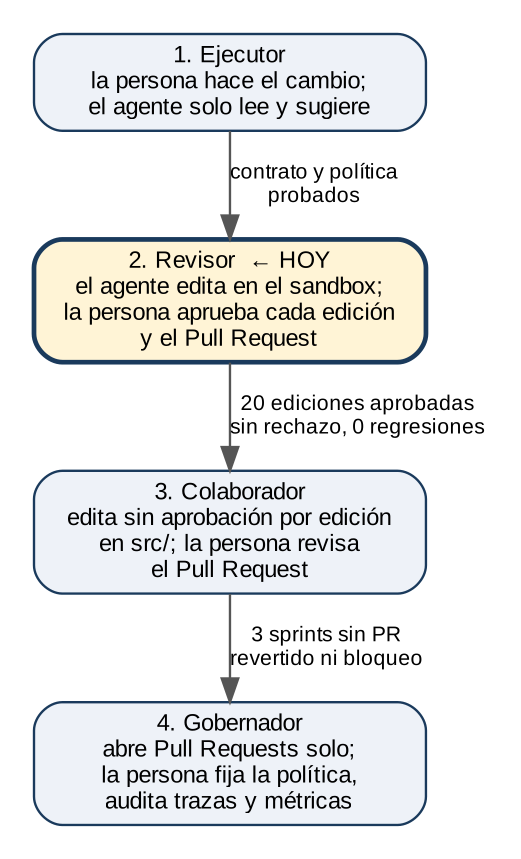

# Humano en el circuito y delegación progresiva (E6)

## Aprobación de ediciones

La política del ejecutor recibe `aprobar_edicion` (antes no se podía pasar al constructor; ver bitácora, entrada 2). Con `--humano consola`, cada `editar_archivo` que pasa las reglas se detiene en el estado `EsperandoAprobacion`: la consola muestra el archivo y las líneas de antes y después, y solo acepta `s` o `n`. Cualquier otra respuesta ("si", "x", vacío) se rechaza y se vuelve a preguntar. Las respuestas quedan en `trayectorias/<corrida>/humano.json` para reproducir la corrida con `--humano grabado`.

```text
python orquestador.py --issue 2 --modo coordinado --humano consola
```

En la corrida `issue2_coordinado_humano` el integrante aprobó las dos ediciones (`llegada.py` en la ronda 1 y `servicio.py` en la ronda 2). Un `n` llega al agente como observación ("El revisor humano rechazó la edición") y queda en la traza como `RECHAZADO_POR_HUMANO`. Las pruebas `test_consola_solo_acepta_s_o_n` y `test_consola_rechazo_y_grabado_reproducen_lo_mismo` cubren los dos casos.

## Hoja de ruta: de ejecutor a gobernador



| Etapa | Qué hace la persona | Permisos del agente en RutaSIT | Evidencia de las trazas para pasar a la siguiente |
|---|---|---|---|
| 1. Ejecutor | Escribe el cambio. El agente solo lee y sugiere. | `listar_archivos`, `leer_archivo`, `buscar`, `mapa_repo`, `ejecutar_pruebas`. Sin `editar_archivo`. | Contrato y política probados (`pruebas_agente/`, 37 pruebas) y al menos 5 trayectorias sin `CONTRATO_INVALIDO` repetido. |
| 2. Revisor (hoy) | Aprueba cada edición con `s`/`n` y aprueba el Pull Request. | Lo anterior + `editar_archivo` en `src/` del sandbox + comandos de la lista. `test/` y `tests/` protegidas. | 20 ediciones aprobadas seguidas sin un `n`, 0 regresiones en la suite y 0 acciones bloqueadas por intentar salir del sandbox. Hoy hay 2 ediciones aprobadas: falta evidencia. |
| 3. Colaborador | Ya no aprueba cada edición; revisa el Pull Request completo que arma el sistema actor-crítico. | Edición sin aprobación en `src/rutasit/`. El revisor de solo lectura sigue siendo obligatorio. `aprobar_edicion` solo para archivos fuera de `src/rutasit/` (por ejemplo, `servicio.py` del puerto público). | 3 sprints sin un Pull Request revertido, sin hallazgos de seguridad del revisor y con el contexto por issue estable (menos de 40 000 caracteres). |
| 4. Gobernador | Define la política, la lista de comandos y los presupuestos; audita trazas y métricas cada semana. | Abre Pull Requests en una rama propia y corre la CI. Nunca fusiona en `main`, nunca usa credenciales reales. | No aplica: es la etapa final, y se vuelve a la etapa 3 ante cualquier incidente (PR revertido, inyección no detectada, regresión en producción). |

Hoy el agente se queda en la etapa 2. Tenemos 6 corridas sobre 3 issues, y en una de ellas (issue 2, agente único) el cambio pasaba la prueba del issue pero dejaba un `TypeError` en `consultar_eta()`. Ese error lo encontró el revisor, no las pruebas, y con esa evidencia no corresponde quitar la aprobación humana.
