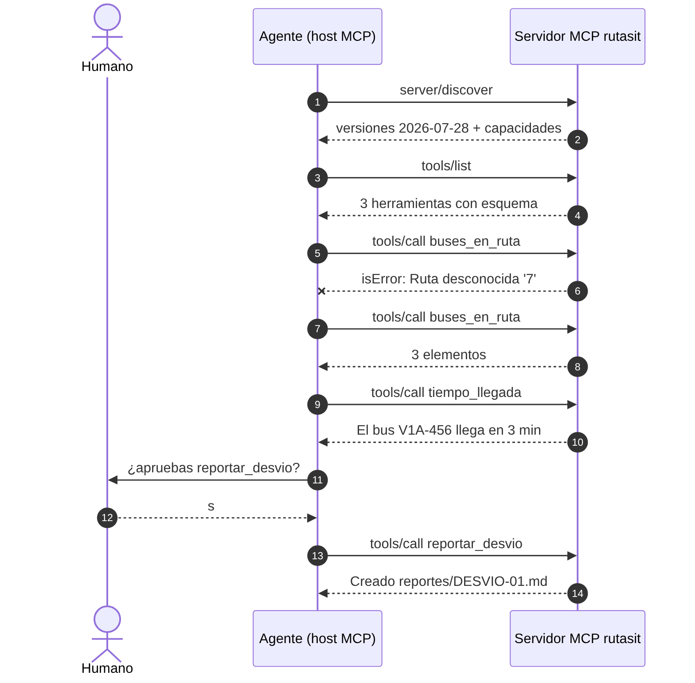
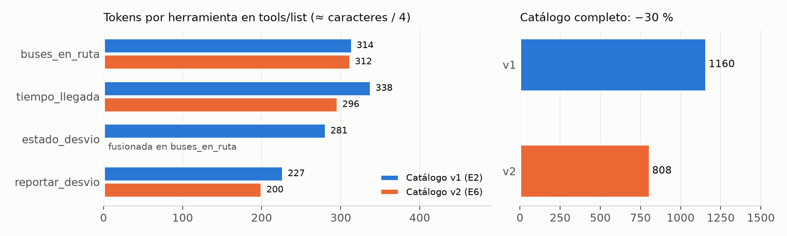
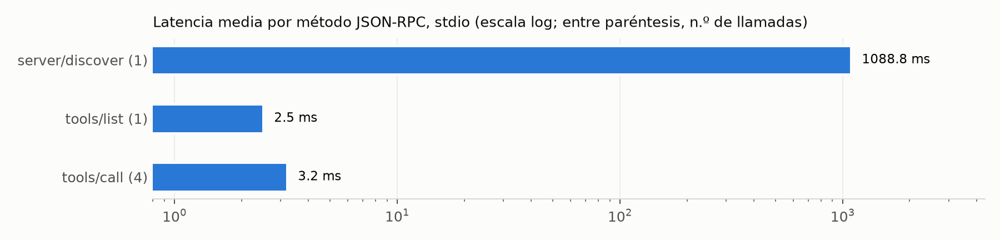

# Análisis del protocolo y del costo de contexto (E6)

Fuente: el tráfico JSON-RPC que el espía (`cliente/espia.py`) capturó en las dos corridas del analista, `trazas/analista_catalogo_v1/` (servidor de E2) y `trazas/analista_catalogo_v2/` (servidor optimizado). El diagrama y las métricas los generan `analista_mcp.py` y `cliente/traza_mcp.py`; los gráficos, `diagramas/metricas_mcp.py`.

Las corridas se reprodujeron con Python 3.12.16 y mcp 2.3.0, usando decisiones y aprobación grabadas del material suministrado. No se ejecutó una nueva aprobación humana en consola. Las métricas siguientes corresponden a las trazas incluidas en esta rama.

## Diagrama de secuencia generado



El host empieza con `server/discover` (protocolo 2026-07-28, sin `initialize` ni sesión), pide el catálogo una vez y luego hace 4 llamadas. El primer `tools/call` vuelve con `isError: true` porque el agente pasó la ruta como "7"; el mensaje trae los códigos válidos y la siguiente llamada usa `R-07`. Antes de `reportar_desvio` el agente pide aprobación al humano.

Una petición real y su respuesta:

```json
{"jsonrpc": "2.0", "id": 5, "method": "tools/call",
 "params": {"name": "tiempo_llegada", "arguments": {"ruta": "R-07", "paradero": "Plaza de Armas"},
            "_meta": {"io.modelcontextprotocol/protocolVersion": "2026-07-28",
                      "io.modelcontextprotocol/clientInfo": {"name": "agente-rutasit-lab10", "version": "1.1"},
                      "io.modelcontextprotocol/clientCapabilities": {}}}}

{"jsonrpc": "2.0", "id": 5,
 "result": {"content": [{"type": "text", "text": "{ \"ruta\": \"R-07\", ... }"}],
            "structuredContent": {"ruta": "R-07", "paradero": "Plaza de Armas", "disponible": true,
                                  "minutos": 3, "placa": "V1A-456", "mensaje": "El bus V1A-456 llega en 3 min"},
            "isError": false, "resultType": "complete",
            "_meta": {"io.modelcontextprotocol/serverInfo": {"name": "rutasit"}}}}
```

Cada petición lleva en `_meta` su versión de protocolo y la identidad del cliente, por eso no hace falta una sesión. La respuesta trae el resultado dos veces: como texto (para hosts que no leen `structuredContent`) y como objeto tipado.

## Métricas

| Métrica | Catálogo v1 (E2) | Catálogo v2 (E6) | Cambio |
|---|---|---|---|
| Herramientas en el catálogo | 4 | 3 | −1 (`estado_desvio` fusionada) |
| Tokens del catálogo (`tools/list`, caracteres / 4) | 1160 | 808 | −352 (−30 %) |
| Mensajes JSON-RPC de la consulta | 14 | 12 | −2 |
| Bytes de la consulta | 10 884 | 8 463 | −22 % |
| Pasos del agente (incluye el final) | 6 | 5 | −1 |
| Contexto final del agente (caracteres) | 5 680 | 4 365 | −23 % |
| Errores (`isError`) | 1 | 1 | el mismo error de la ruta "7", corregido |

| Método | Latencia media (v2) | Llamadas |
|---|---|---|
| `server/discover` | 1088,8 ms | 1 (incluye arrancar el proceso de Python) |
| `tools/list` | 2,5 ms | 1 |
| `tools/call` | 3,2 ms | 4 |





En esta corrida, el descubrimiento inicial, incluido el arranque del servidor, tomó 1088,8 ms; las llamadas a herramientas promediaron 3,2 ms. Son mediciones locales, no garantías de rendimiento. El costo que importa es el de contexto. El catálogo viaja al modelo en cada decisión, así que con v1 la consulta gastó unos 6 × 1160 ≈ 6 960 tokens solo en describir herramientas, y con v2 unos 5 × 808 ≈ 4 040 (es una estimación: depende de cómo arme el prompt cada host).

## Optimización aplicada

1. Fusionamos `estado_desvio` en `buses_en_ruta`. La traza de v1 mostró que el agente llamaba a las dos, una tras otra, sobre la misma ruta. Ahora cada bus trae `distancia_ruta_m` y `desviado`.
2. Quitamos de `buses_en_ruta` la latitud y longitud, que el agente nunca usó (el mapa sigue en el recurso `rutasit://rutas`).
3. Acortamos las tres descripciones a lo que el modelo necesita para elegir: qué hace, formato de cada parámetro y qué pasa en el caso borde. Por ejemplo, `tiempo_llegada` bajó de 338 a 296 tokens.

`buses_en_ruta` casi no bajó (314 → 312 tokens): ganó dos campos en su `outputSchema` y perdió texto en la descripción. Casi la mitad del catálogo son los esquemas de salida, así que el siguiente recorte posible sería devolver menos campos, no escribir menos.

## ¿Siguió el agente eligiendo bien?

Sí. Con el catálogo v2 resolvió la misma consulta con un paso menos (5 en vez de 6) y la misma respuesta: V1A-456 en 3 min y el reporte del desvío de V2B-789 con la aprobación grabada. Cometió el mismo error con la ruta "7", lo que indica que ese error viene de la forma de la consulta y no de las descripciones. La prueba `test_catalogo_optimizado_cabe_en_900_tokens` evita que el catálogo vuelva a crecer sin que nadie lo note.

## Cliente actual frente a cliente antiguo

`cliente/comparar_ciclo.py` conecta dos clientes al mismo servidor a través del espía:

```text
cliente_actual   protocolo 2026-07-28: server/discover -> tools/list -> tools/call
cliente_antiguo  protocolo 2025-11-25: initialize -> notifications/initialized -> tools/list -> tools/call
```

El servidor atiende a los dos. Eso importa en la práctica: MCP Inspector y algunos hosts todavía hablan la versión 2025.
