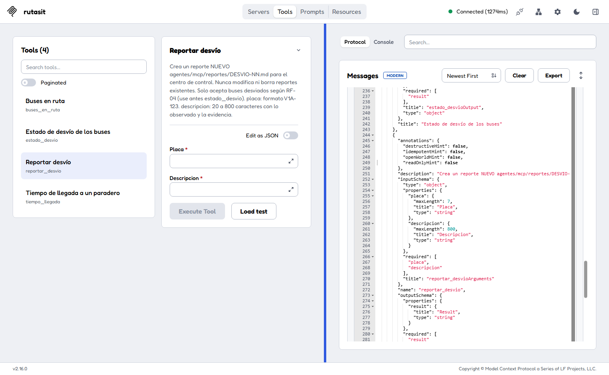
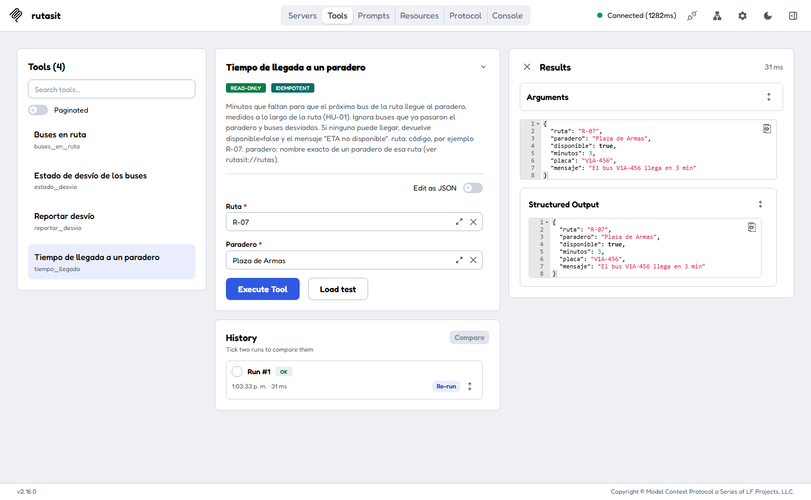
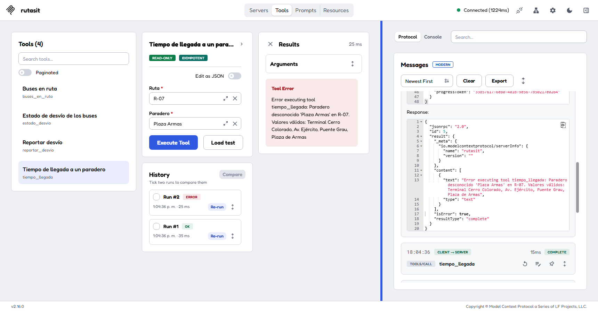

# Evidencias de MCP Inspector (E3)

Servidor: `agentes/mcp/servidor_mcp/rutasit_mcp.py` · MCP Inspector 2.16.0

> Pendiente de verificación: las salidas siguientes provienen del material entregado;
> MCP Inspector no se volvió a ejecutar al preparar esta rama. Las tres capturas
> enlazadas todavía no están incluidas y deben obtenerse con la interfaz web.

```text
npx @modelcontextprotocol/inspector python agentes/mcp/servidor_mcp/rutasit_mcp.py          # interfaz web
npx @modelcontextprotocol/inspector --cli python agentes/mcp/servidor_mcp/rutasit_mcp.py --method tools/list
```

Revisamos lo que pide el Paso 5: que cada descripción se entienda sin leer el código, que un argumento inválido devuelva un error útil y que la plantilla `rutasit://adr/{numero}` acepte `001` y rechace `../../secretos`. Las salidas de texto de abajo son del modo CLI; las capturas de la interfaz web van en el informe.

## Captura 1: catálogo



Salida de `--method tools/list` (resumida) con el servidor de E2:

```text
buses_en_ruta   | readOnly True  | destructive False | maxLength {'ruta': 10}
tiempo_llegada  | readOnly True  | destructive False | maxLength {'ruta': 10, 'paradero': 60}
estado_desvio   | readOnly True  | destructive False | maxLength {'ruta': 10}
reportar_desvio | readOnly False | destructive False | maxLength {'placa': 7, 'descripcion': 800}
```

Comentario: las cuatro descripciones dicen qué devuelven y el formato de cada parámetro (`R-07`, `V1A-123`, nombre exacto del paradero). Solo `reportar_desvio` es de escritura y lo dice su anotación. Todos los textos tienen `maxLength`. La optimización del catálogo corresponde a E6, en una entrega posterior.

## Captura 2: llamada correcta



`tools/call tiempo_llegada` con `ruta=R-07` y `paradero=Plaza de Armas`:

```json
"structuredContent": {"ruta": "R-07", "paradero": "Plaza de Armas", "disponible": true,
                      "minutos": 3, "placa": "V1A-456", "mensaje": "El bus V1A-456 llega en 3 min"},
"isError": false
```

Comentario: la respuesta trae `structuredContent` validado contra el `outputSchema` (tipo `Llegada`). El bus V2B-789 está más cerca en kilómetros, pero está desviado y no se cuenta.

## Captura 3: llamada con error



`tools/call tiempo_llegada` con `paradero=Plaza Armas`:

```json
"text": "Error executing tool tiempo_llegada: Paradero desconocido 'Plaza Armas' en R-07. Valores válidos: Terminal Cerro Colorado, Av. Ejército, Puente Grau, Plaza de Armas",
"isError": true
```

Comentario: es un error de negocio (`isError: true`), no un error de JSON-RPC, y lista los valores válidos para que el modelo se corrija en el paso siguiente.

## Recurso plantilla

```text
resources/read rutasit://adr/001                → "# ADR-001: Adoptar un monolito modular para el MVP de RutaSIT ..."
resources/read rutasit://adr/..%2F..%2Fsecretos → {"error": {"message": "Unknown resource: rutasit://adr/..%2F..%2Fsecretos"}}
```

La plantilla no coincide con `..%2F..` y, si llegara un valor raro, el servidor solo acepta `\d{3}` y busca dentro de `docs/architecture/adr/`.
