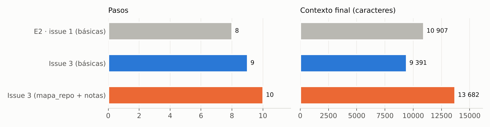
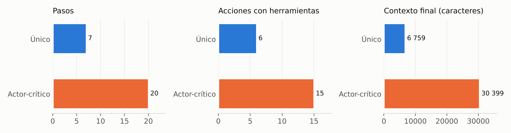

# Observación del sistema agéntico (E4 y E5)

Todas las cifras salen de `trazas/<corrida>/metricas.json` y `resumen.json`, generados por `orquestador.py` y `agente/traza.py`. Los gráficos se regeneran con `python diagramas/metricas.py`.

## E4. Herramienta nueva (`mapa_repo`) y memoria de notas

`mapa_repo(carpeta)` recorre los `.py` con el módulo `ast` y devuelve módulos, clases, métodos y funciones con su firma y línea, sin leer el código completo. `anotar(texto)` y `leer_notas()` guardan una pizarra en `notas.md` del sandbox (nota de la corrida en `trazas/issue3_unico_mapa/notas.md`).

| Corrida | Pasos | Contexto final | Cómo ubicó el código |
|---|---|---|---|
| E2: issue 1, herramientas básicas | 8 | 10 907 | el traceback de pytest ya señalaba `gps.py:27` |
| Issue 3, herramientas básicas | 9 | 9 391 | `buscar("def (distancia_a_ruta\|hay_desvio)")`: 132 caracteres |
| Issue 3, `mapa_repo` + notas | 10 | 13 682 | `mapa_repo("src")`: 4 001 caracteres |

Con las herramientas nuevas el agente no necesitó menos pasos ni menos contexto: usó 1 paso más y 4 291 caracteres más (+46 %) que la misma tarea con herramientas básicas. El mapa de 15 módulos ocupa 30 veces más que una búsqueda con un patrón preciso, y el catálogo extendido agrega 459 caracteres al objetivo. Frente a E2 (issue 1) también usó más pasos y contexto, aunque ahí la comparación es entre issues distintos. En un repositorio de este tamaño, `buscar` es más barato cuando el issue nombra la función. El mapa sirve cuando el issue no dice dónde mirar o el cambio cruza módulos, y las notas sirven para pasar información entre rondas: el ejecutor de la ronda 2 empieza con historial nuevo, pero el sandbox (y `notas.md`) se conserva.

## E5. Agente único frente a actor-crítico (issue 2)

| Variante | Rondas | Pasos | Acciones | Bloqueadas | Contexto final | ¿Encontró el `TypeError` de `consultar_eta`? |
|---|---|---|---|---|---|---|
| Agente único | 1 | 7 | 6 | 0 | 6 759 | No: la prueba del issue pasó y terminó |
| Planificador + ejecutor + revisor | 2 | 20 | 15 | 0 | 30 399 (planificador 1 190; ejecutor 7 160 + 8 786; revisor 9 642 + 3 621) | Sí: el revisor buscó los llamadores y pidió cambios |

Conclusión. El agente único devolvió `None` en `minutos_hasta_paradero()`, pasó la prueba del issue y terminó, pero dejó roto `ServicioEta.consultar_eta()`: con la estrategia `RECORRIDO` publica "llega en None min" y luego evalúa `None > 20`, que lanza `TypeError` (lo comprobamos ejecutando el servicio). El revisor lo encontró porque buscó a los llamadores del código cambiado, algo que la prueba del issue no cubre. Ese hallazgo costó 2,9 veces más pasos y 4,5 veces más contexto. Por el principio de parsimonia, en RutaSIT el actor-crítico se justifica cuando el cambio altera un contrato que otros módulos usan (tipo de retorno, firma, evento), como en el issue 2. En arreglos locales como los issues 1 y 3 basta un agente único con la aprobación humana.
