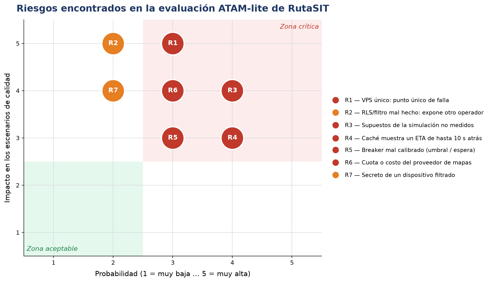

# Evaluación ATAM-lite — RutaSIT Arequipa (Lab 08)

## A. Evaluación de nuestra propia arquitectura
Se aplicó el Prompt IA 3 (evaluador adversario) al árbol de utilidad, los ADR-006 a 008, la vista de contenedores y los resultados de las simulaciones. Cada hallazgo se verificó contra la evidencia.

| Tipo | ID | Hallazgo | Evidencia / respuesta del equipo |
|------|----|----------|----------------------------------|
| Sensibilidad | S1 | El p95 de lectura depende de la tasa de aciertos de la caché | Con solo caché, falla por debajo de ~55 % de aciertos; el índice cubre el caso de caché fría (67 ms). FF-06 |
| Sensibilidad | S2 | La ingesta depende del costo del ETA por mapas | Con ETA híbrido hay margen de 2 veces; con 2,5 veces los tiempos supuestos, colapsa. Plan B: 8 workers |
| Trade-off | T1 | Caché (rendimiento) frente a ETA desactualizado (corrección) | TTL de 10 s, igual al polling del ADR-003: el pasajero ya ve datos de hasta 10 s |
| Trade-off | T2 | ETA por velocidad (rendimiento, disponibilidad) frente a precisión del ETA | Aceptado; se usa mapas en el 10 % de las posiciones |
| Trade-off | T3 | Firma con marca de tiempo (seguridad) frente a relojes de los GPS (disponibilidad) | Ventana de ±60 s; se documenta el requisito de sincronización |
| Riesgo | R1 | Un solo VPS es punto único de falla | Aceptado para el MVP: respaldo diario (nodo en C4) y plan de recuperación en 2 h (ADR-009 pendiente) |
| Riesgo | R2 | Una política RLS mal hecha expone datos de otro operador | Doble defensa: filtro en el repositorio (FF-10) y RLS; falta probar RLS en integración continua |
| Riesgo | R3 | Los tiempos de servicio de la simulación son supuestos, no mediciones | Análisis de sensibilidad (2 veces de margen) y prueba de carga real con Locust antes de publicar |
| Riesgo | R4 | La caché muestra un ETA de hasta 10 s atrás | Aceptado: es el mismo retraso del polling (T1) |
| Riesgo | R5 | Breaker mal calibrado (umbral y espera) | 8 pruebas del circuito; valores configurables; se calibra con datos reales |
| Riesgo | R6 | Cuota o costo del proveedor de mapas | **Mitigado** por ADR-007: llamadas durante la caída bajan de 50 811 a 126; el ETA por velocidad reduce el uso |
| Riesgo | R7 | Se filtra el secreto de un operador | Rotación y límite de tasa en Nginx; secreto por operador limita el alcance |
| No riesgo | NR1 | El monolito modular soporta la consulta y la ingesta del crecimiento | p95 de 41 ms (frente a 1000) y 73 ms (frente a 5000), con los supuestos escritos |
| No riesgo | NR2 | Perder la caché de Redis no pierde datos | ADR-003: Redis solo guarda datos derivados que se reconstruyen desde PostgreSQL |
| No riesgo | NR3 | Agregar un operador GPS no modifica el servicio | `test_open_closed_nuevo_operador_gps_sin_modificar_el_servicio` (Lab 07) |

### Hallazgos del evaluador adversario refutados (falsos positivos)
| Afirmación del evaluador | Verificación | Resultado |
|--------------------------|--------------|-----------|
| "Si Redis se reinicia sin persistencia se pierden datos, como una cola de pagos pendientes" | ADR-003: Redis solo guarda la última posición y el ETA precalculado; se reconstruye desde PostgreSQL. FF-06 mide la caché vacía: p95 de 67 ms | **Falso positivo** |
| "Sin una cola de pendientes, un corte del proveedor pierde consultas" | El ETA es una lectura sin efectos; `ConRespaldo` siempre responde. FF-08: 0 consultas sin ETA | **Falso positivo** |

## B. Matriz de probabilidad e impacto

| Riesgo | Prob. | Impacto | Zona | Mitigación o razón para aceptarlo |
|--------|:-----:|:-------:|------|------------------------------------|
| R1 VPS único | 3 | 5 | Crítica | Se acepta en el MVP; respaldo diario y recuperación en 2 h |
| R3 Supuestos no medidos | 4 | 4 | Crítica | Sensibilidad + prueba de carga real antes de publicar |
| R6 Proveedor de mapas | 3 | 4 | Crítica | Mitigado: circuit breaker (ADR-007) |
| R4 ETA desactualizado | 4 | 3 | Crítica | Aceptado: TTL igual al polling |
| R5 Breaker mal calibrado | 3 | 3 | Crítica | Pruebas y parámetros configurables |
| R2 RLS mal configurado | 2 | 5 | Fuera de la zona crítica | Doble defensa y FF-10 |
| R7 Secreto filtrado | 2 | 4 | Fuera de la zona crítica | Rotación y límite de tasa |

## C. Evaluación cruzada (otro grupo)
> Esta parte requiere la participación de otro grupo. Completar cuando el docente asigne los repositorios.

- **Repositorio que evaluamos:** `<enlace>`
- **Issue que abrimos (1 sensibilidad, 1 trade-off, 2 riesgos con probabilidad e impacto y 1 no riesgo):** `<enlace al issue>`
- **Issue que recibimos:** `<enlace al issue>`

| Hallazgo recibido | ¿Aceptamos o refutamos? | Evidencia |
|-------------------|-------------------------|-----------|
| `<copiar aquí cada hallazgo>` | `<aceptado / refutado>` | `<evidencia>` |
